

 

  
  
  
  
  

---

<!-- ===================== ENGINEERING PROFILE INFOGRAPHICS ===================== -->
<h2 id="about">Engineering Profile</h2>

  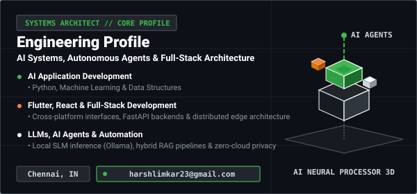

 

  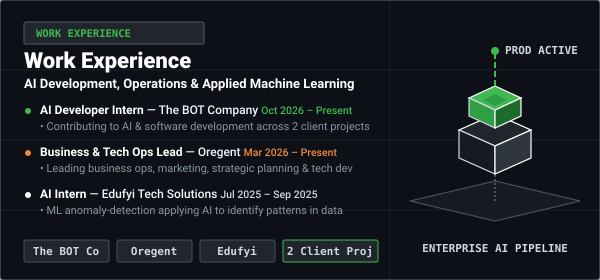

 

  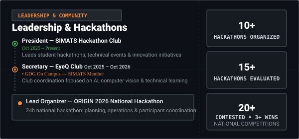

---

<!-- ===================== TECH STACK ===================== -->
<h2 align="center" id="skills">Technical Ecosystem</h2>

  
    
  
    
  

 

<table align="center" width="100%">
  <tr>
    <td align="center" width="22%">
      
    </td>
    <td>
      
      
      
      
      
      
    </td>
  </tr>
  <tr>
    <td align="center">
      
    </td>
    <td>
      
      
      
      
      
      
    </td>
  </tr>
  <tr>
    <td align="center">
      
    </td>
    <td>
      
      
      
      
      
      
    </td>
  </tr>
</table>

---

<!-- ===================== PRODUCTION SYSTEMS ===================== -->
<h2 align="center" id="projects">Production Systems</h2>

<!-- 1. SPYDEE -->

  <a href="https://github.com/harshlimkar/SPYDEE">
    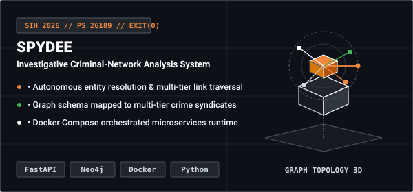
  </a>
  

    <a href="https://github.com/harshlimkar/SPYDEE"><strong>View Repository on GitHub →</strong></a>
  

 

<!-- 2. FORENSIC-ANALYSER -->

  <a href="https://github.com/harshlimkar/Forensic-Analyser">
    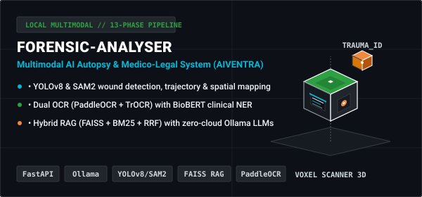
  </a>
  

    <a href="https://github.com/harshlimkar/Forensic-Analyser"><strong>View Repository on GitHub →</strong></a>
  

 

<!-- 3. SPIC -->

  <a href="https://github.com/harshlimkar/spic-project">
    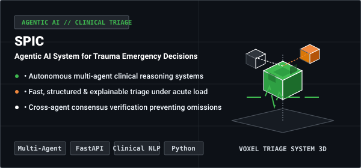
  </a>
  

    <a href="https://github.com/harshlimkar/spic-project"><strong>View Repository on GitHub →</strong></a>
  

 

<!-- 4. HackHub -->

  <a href="https://github.com/harshlimkar/hackhub">
    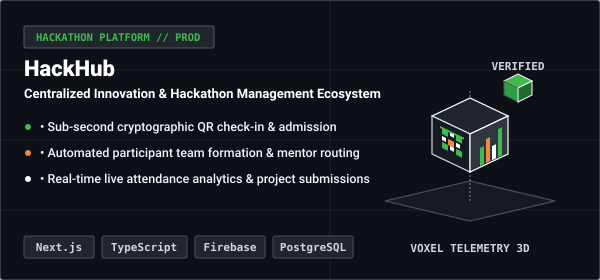
  </a>
  

    <a href="https://github.com/harshlimkar/hackhub"><strong>View Repository on GitHub →</strong></a>
  

 

<!-- 5. EyeQ Vision -->

  <a href="https://github.com/harshlimkar/eyeq-vision-vibe">
    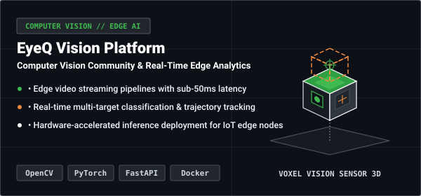
  </a>
  

    <a href="https://github.com/harshlimkar/eyeq-vision-vibe"><strong>View Repository on GitHub →</strong></a>
  

 

<!-- 6. iTantra -->

  <a href="https://github.com/harshlimkar/iTantra">
    
  </a>
  

    <a href="https://github.com/harshlimkar/iTantra"><strong>View Repository on GitHub →</strong></a>
  

 

<!-- 7. HackRx Query System -->

  <a href="https://github.com/harshlimkar/hackrx-query-system">
    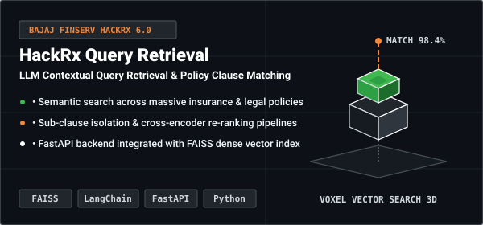
  </a>
  

    <a href="https://github.com/harshlimkar/hackrx-query-system"><strong>View Repository on GitHub →</strong></a>
  

 

<!-- 8. AgriVoice AI -->

  <a href="https://github.com/harshlimkar/Agrivoice">
    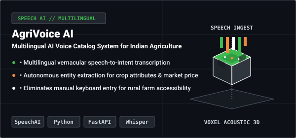
  </a>
  

    <a href="https://github.com/harshlimkar/Agrivoice"><strong>View Repository on GitHub →</strong></a>
  

 

<!-- 9. Carecrypt -->

  <a href="https://github.com/harshlimkar/Carecrypt">
    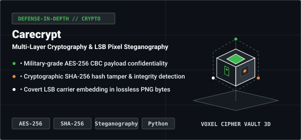
  </a>
  

    <a href="https://github.com/harshlimkar/Carecrypt"><strong>View Repository on GitHub →</strong></a>
  

---

<!-- ===================== SNAKE ANIMATION ===================== -->
<h2 align="center">Contribution Snake</h2>

  <picture>
    <source media="(prefers-color-scheme: dark)" srcset="https://raw.githubusercontent.com/harshlimkar/harshlimkar/output/github-contribution-grid-snake-dark.svg">
    <source media="(prefers-color-scheme: light)" srcset="https://raw.githubusercontent.com/harshlimkar/harshlimkar/output/github-contribution-grid-snake.svg">
    
  </picture>

---

<!-- ===================== PROFILE SUMMARY INFOGRAPHICS ===================== -->
<h2 align="center">Profile Activity Infographics</h2>

  <table width="100%">
    <tr>
      <td width="33%" align="center">
        
      </td>
      <td width="33%" align="center">
        
      </td>
      <td width="33%" align="center">
        
      </td>
    </tr>
  </table>

---

<!-- ===================== GITHUB TELEMETRY ===================== -->
<h2 align="center">GitHub Telemetry &amp; 3D Contribution</h2>

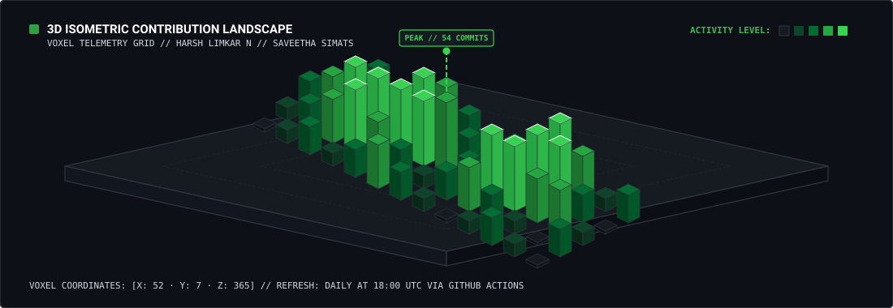

  

<table width="100%">
  <tr>
    <td width="50%" align="center">
      
    </td>
    <td width="50%" align="center">
      
    </td>
  </tr>
</table>

 

  

---

<!-- ===================== FOOTER ===================== -->

 

<em>"Architecting deterministic AI workflows at the intersection of autonomy, systems engineering, and visual intelligence."</em>

  

**Harsh Limkar N** · Saveetha School of Engineering (SIMATS), Chennai

